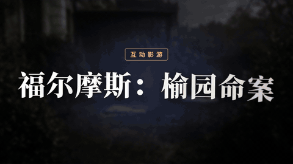

# 白模工坊

输入一段完整的故事或一个梗概，一步步变成能走进去玩、也能从头看到尾的短片：

**故事 → 章节和锚点 → 人物 → 地点图 → 写戏 → 白模 → 生成 → 互动 → 观看**

每一步写出来的东西都能看、能改，也能用一句话告诉 Agent 怎么改。

生成思路来自 `../whitebox-loop` 的实验《闭馆之后》：引擎决定人物位置、碰撞和遮挡，模型只负责画面。这里把那条写死在一个房间上的管线，整理成了任何故事都能走的工作流。

## 预告片

[](https://github.com/lyk555/whitebox-studio/raw/main/docs/trailer.mp4)

《福尔摩斯：榆园命案》是用一段 1674 字的故事生成的互动影游：6 个地方，成片 10 分 36 秒。上面是几个片段，没有声音。完整的 48 秒预告片带台词和配乐：[下载 trailer.mp4](https://github.com/lyk555/whitebox-studio/raw/main/docs/trailer.mp4)（720p，6.6 MB）。GitHub 不在网页里播放它，所以是下载。

## 运行

需要 Node.js、ffmpeg，以及 Chrome 或 Edge（用来渲染白模和视频首尾帧）。

双击 `start.bat`，它会打开 <http://127.0.0.1:8810>。关闭它的窗口即可停止。不是 Windows 的话，先 `npm install`，再 `npm start`。

密钥在页面的“设置”里填，保存在 `.env`，不进版本库。作品和生成的素材都在 `projects/`，也不进版本库。

这个目录旁边如果有 `../whitebox-loop` 实验，没填密钥时会用它 `.env` 里的，作品库里也会多一个只读示例《闭馆之后》。没有也不影响使用。

有密钥时，新作品默认是**正式生成**，每次花钱前都会先确认。在“生成”页可以切到**预演**：不调用图像和视频模型、不花钱，用占位素材把整个流程走完。拆解故事和布景是文字，有密钥就用真实文本模型；没有密钥才用占位内容。

环境变量 `STUDIO_NO_KEY=1` 让这个服务当作没有密钥：文字和画面都是占位内容，一分钱都不会花，用来把流程从头走到尾。

只读示例《闭馆之后》的素材直接读取实验目录，打开就能玩。

## 章节、锚点和地点图

新作品都走这条路（`flow: 'chapters'`）。旧作品还是一场接一场，点“重新分章节和锚点”才会换过来。

1. **章节和锚点**（`story:outline`）：模型把故事或梗概分成几章，每章定几个锚点。锚点是观众亲身经历的转折：之前以为什么，这一刻发生什么，之后以为什么。写全了的故事照原样分，只有梗概的先想成一个真正的故事。同一章里可以有不分先后的锚点，章节页上排在同一列，玩家可以自己选。一章的最后一个锚点总是最后发生。一位制片人读后可以退回重想，最多 3 稿。
2. **人物**（`story:cast`）和**地点图**（`story:world`）：地点图是设计出来的：有哪些地方，哪些相连，哪条路等哪个锚点之后才通，从哪里开始。代码只查拍摄限制和走不走得通：一个地方最多 3 个出口，都在远端边界上；两个地方之间只有一条路；按锚点走一遍，每个地方都要到得了。
3. **写戏**（`story:script`）：一个锚点一个锚点写纯文本剧本，只给编剧看观众一定已经看过的东西。一位第一次看的观众读完说感受，再判断转折有没有发生，没有就换人重写，最多 3 稿。全部写完后两位读者和制片人读一遍，最多重写 3 段。再由场记对一遍前后（见下面“前后对得上”），然后把每一步拆成拍摄要用的东西（物件、视频内容、露脸镜头、道具）。**旁白和台词由代码从剧本里取，场记碰不到**，所以写的是什么，屏幕上就是什么。
4. **白模、生成**：和以前一样。每个地方有自己的布景，地方里的物件是所有锚点要用的东西的合集，同一件东西可以在不同锚点再用。

这几步只在你要求时才运行。改了它们写的东西不会让模型回来重写，也不会悄悄把戏冲掉；想重写，点那一页的“重新生成”。

### 前后对得上

《雾都码头谜案》写出来的戏每一段都“转折发生了”，连起来却对不上：上一段说“你居然敢单独来”，下一段是“我提前通知的增援到了”；画在卡特怀里，后来到了福尔摩斯手上；高潮靠三个没有名字的便衣，画面上拍不出来。原因是每一段只看得到它之前的剧本，读者只被问戏好不好。现在这样改：

- **编剧知道什么拍得出来。** 大纲、地点图和每一段的编剧都被告知：画面里只能有人物表里的人，没有群演；人在一个地方露面后就一直站在那里；别人做的事只在他露面的近景里看得到；观众没看到的安排不能用一句旁白补上。大纲还要求一个锚点的“之前以为”和前面的锚点接得上，制片人会把转折连起来读。
- **被告知不算经历。** 判断转折有没有发生时，会拿到这一段的形状（几步，几步没有别人开口，谁说了几句，代码数的）。观众只是复述旁白或主角说出口的结论，不算发生；只有一步、只有主角开口的一段多半也不算。
- **场记对前后。** 全片评审之后，一次调用只找确凿的矛盾：东西在谁手里、人在哪、观众没看到的事被当成发生过、两段事实相反、和真相相反、不在人物表里的人在做事、地方对不上。有问题的段只改那几句，其他字不动，改完再对一遍，最多 2 轮；改完拍不了就留着原来的。还剩下的写在这一步的日志里。
- **人物名不剧透。** 名字是字幕上写在台词前面的，带“受贿”“真凶”“内鬼”这类词的退回去重起。人物的 personality 还要写他想要什么、瞒着什么。
- **出口画的是这一边。** `beyond` 是站在这边透过出口看得到的一小片，不是目的地里面的样子；离得远的两个地方，出口就是通往那边的路。开场视频不写具体物件（特写拍哪一件到写戏之后才定）、不写别人、不写人声，称“主角”不用“我”。
- **场记不添一样的东西。** 剧本说“墙边的木箱”“门口的木箱”，都绑在这个地方已有的“木箱”上（去掉位置和编号后同名就算同一件）。进画面的文字里，道具 id 由代码换成道具名，抄进露脸描述里的台词由代码删掉。动作从主角已经站在东西前写起，不写走过去。

这些只影响以后写的故事。已经写好的剧本和已经拍好的镜头都不变，提示词和哈希也不变。模型的判断仍然会错，对前后这一层只是多一道提醒。

### 一个镜头里的话不打架

同一段提示词里两句话互相矛盾时，视频模型只能挑一句听。《雾都码头谜案》的 50 段镜头里读出来这些（`platform/prompts.mjs`，文字的清理在 `platform/wording.mjs`）：

- **人已经站在那里。** 游戏拍一步的第一帧时，主角已经站在这一步的东西前，而动作常常从“缓步走到书桌旁”写起。让他走到他站着的地方，模型会让他走开再回来，或者再带进来一个人。动作里有“走到、走向、挪到”这类词时，提示词先说他已经站在这件东西前，走过来的部分略过。
- **对着场上的人说话不是自言自语。** 露脸镜头里只有主角一个人时，原来一律写“他在自言自语”。场上站着三个人，福尔摩斯对布朗说“增援是从邻区调的”，拍出来是对着自己的手嘀咕。现在场上有别人时写“别人都在画面外，这些话是说给他们听的”；没有定妆照的人仍然不许进画面。场上没人时还是自言自语。
- **全景和手上的细节。** 场上有别人时镜头不推近，动作却写的是指尖和纽扣。现在说明白：细节在全景里看不清没关系，看得出主角在做这件事就行。
- **黑场在台词之后。** 一章收尾的露脸镜头，原来第一句就是“最后画面暗下去，所有声音消失”，后面才是台词，时长也只够说台词。现在这句放在镜头内容之后，写明台词说完才暗，并多给 2 秒（最长仍是 12 秒）。
- **踹门只响一次。** 一步的 `sound` 是给手部动作写的，原来三段镜头都带着它，门就被踹开三次。场记现在另写一条 `ambience`（这个地方一直有的环境声），露脸镜头和收尾特写用它；没写就和以前一样。
- **写进镜头的文字由代码收拾。** 道具 id 换成道具名，抄进露脸描述里的台词删掉。场记交上来时就改一遍，拼提示词时再查一遍，手改和 Agent 改的也管得到。动作、露脸、特写各自补上句号，不然会连成“并排放置比对声音：……”。
- **场记把人写成站着。** 游戏画面里所有人都是站着的，露脸镜头前后都要切回去，所以 face 里不写谁坐着、蹲着、被按住。

每一条都只在那种情况出现时才改提示词，其他镜头一个字不变。《雾都码头谜案》的 50 段里有 22 段会变（16 段手部动作、6 段露脸，共 129 秒视频），其余 28 段和布景、首尾帧的哈希都和原来一样；这 22 段不重拍就还是原来的画面。补句号和 `ambience` 是写进数据里的，旧项目的步骤没有，所以旧的开场和收尾特写不动。

还没解决的：露脸描述里写到没有名字的人（“被便衣按住”），只靠场记的提示词拦，代码认不出来；两个不分先后的锚点落在同一个地方时，首尾帧是按步骤列出的顺序算谁在场的，玩家倒着做，画面里的人会对不上。

**地点和戏是分开的。** 故事的先后在锚点里（`anchor.steps`），每一步存在它发生的地方（`scene.beats`），所以布景、白模和镜头都还是按一个地方来做。同一个地方可以在不同锚点、不同章节回来。

**出口。** 每个出口通向固定的地方（`scene.exits`），都画在这个地方的远端，是门或路口。出口不在画面上打开，也不拍镜头，走过去按 E 就切到黑场和地名。第一次到一个地方放它的开场视频，站到开场的落点；以后回来不放，站在来时那个出口旁边。

**章末。** 一章的最后一步拍到慢慢全黑，这一章就收在那里，接着是下一章的章名，到下一章开始的地方。所以一个地方没有自己的推门镜头和结尾镜头，比一场接一场省视频。

**进度。** 每个地方是一个页面，玩家做过什么由互动页保管，换地方时带过去（`runtime/journey.js`，游戏、互动页和生成前的检查读的是同一份）。手里的道具一路带着，所以道具图在其他地方也有一份。

**成片。** 按写作的顺序走一遍：每一步按锚点的顺序，一个地方第一次到时接它的开场。走不通的故事不能开始生成。

**不分叉。** 全片一个结局。不分先后的锚点让玩家有得选，但不多拍视频；每多一条分支要多拍一套，所以没有分支。

**Agent。** 从有了章节开始就能用，也知道你在哪一页。章节、锚点、地点、路、人物、台词、白模都能改。改完走不通的修改会被退回，不会让故事卡住。

## 八步

1. **故事**：写一段完整的故事，或者一个梗概。
2. **章节**：一章一行，从左到右是锚点。点一个锚点能改，写完戏之后还能看到它拍成哪几步、这一段的剧本、第一次看的观众怎么说。
3. **人物**：定妆表。只有一个主角由玩家操作，其他人物只出现在视频的露脸镜头里。每个人有一句声音描述。可以单独生成定妆照。
4. **地点图**：图上点一个地方，下面是从这里能去哪、这里发生的事。这一页的按钮写每个锚点的戏。（旧作品这一页还是分镜板，一场一场从左到右。）
5. **白模**：平面图上拖动物件，看机位范围和站位；切到“走进去”用真实碰撞试走。右边可以直接和布景师说：加一台打字机、把柜子做高、整个地方再大一点、改成室外。这一步只用文本模型，不产生图像和视频费用。
6. **生成**：制作看板，人物、布景、镜头做好一样亮一样，旁边是实时动态。切到“流程图”能看全部步骤、提示词、指标和失败原因。
7. **互动**：放映厅。走到出口按 E 去相连的地方，旁边是这一章的锚点和地点图，点图上的地方可以直接过去看看。没生成的地方先用白模玩。（旧作品走出一场的门，自动进入下一场。）
8. **观看**：所有镜头按故事顺序接成一部片子，带字幕，可以按片段跳转和下载。下载的文件里没有字幕。

## 完整的故事（旧作品）

这一节只说换到章节之前的作品，新作品不走这一步，也不查这些规则。

一句题材或几句话不是一个故事。这些项目在拆人物之前多一步“写完整故事”（`story:plot`），模型把原文写成全文，同时写出每个地方发生什么。代码检查写出来的东西，不合格就带着原因退回去：

- 全文不能比原文短，原文写到的不能丢。
- 原文不到 800 字时：其他故事至少 4 个地方；案件至少 5 个地方、3 个嫌疑人、5 条线索。写了 800 字以上就按原文来，一个房间的故事不会被凑成几个地方。
- 案件要有真凶、动机、一次判断失误、一条误导线索和推理，要求由主角自己破案，不能靠受害者说出真相或凶手主动坦白。每个嫌疑人都要露面，真凶在揭晓之前就要露面，最后一个地方要在场。这些只查有没有，不查好不好，好不好要人读。

你最初写的那段留在 `premise`，故事页右边能看到。之后手动改全文不会让这一步重跑；点“重新拆解”时，框里现在的文字就是新的原文。这一步之前读过的旧项目没有 `premise`，什么都不变，也不多这一步。

全文也要够长：平均每个地方不到 150 字是提纲，退回去。

场景一场一场地写，所以多长的故事都不会超过单次回答的上限，哪一场不合格就只退回哪一场。这里要露面的人必须进这一场的露脸镜头，并且一问一答，不能只有一个人在说。揭晓那一场，主角要亲口说出推理。墙、门、窗不能当互动的东西。

全部写完后，模型再通读一遍（最多改 2 轮），只看观众实际看得到的旁白和台词：线索交代了没有，判断失误演出来没有，结局说清楚没有，前后接不接得上。哪一场有问题就只重写哪一场，后面的场如果依赖它，才跟着重写。还有疑问就留在这一步的日志里。

写完后从不露面的人物会从人物表里去掉，不为他画定妆照。

## 台词

人物在视频里开口说话：台词（`lines`）写在露脸镜头上，提示词要求按原话说、口型对上，并带上人物的声音描述。镜头时长按台词算（每秒 5 个字），5 到 12 秒，大约说得完 45 个字，说不完的退回去，并告诉模型现在多少字、要删多少。一个露脸镜头除主角外最多两个人，说话的人必须在镜头里。

没有台词的镜头提示词一个字都不变，所以已经拍好的旧项目不会失效。**真实的视频模型说台词还没有试过**，不同镜头里同一个人的声音能不能保持一致也不知道。

不露脸、钉在游戏画面上的镜头仍然没有人声。互动时屏幕下方按时间显示台词，成片的字幕（`captions.vtt`）是看的时候从故事现算的，改一句旁白马上就对，不花钱。

## 配角站在场上

以前配角只在露脸镜头里出现：游戏里和接着游戏的那段镜头里都没有他，切到特写时人突然冒出来。《雾都码头谜案》里华生和老乔都是这样。现在新故事里的配角就站在房间里，玩家一进来就看得到（`platform/people.mjs`）。

- **谁站在哪，从什么时候起。** 某一步的露脸镜头里看得到、或者开口说话的配角，站在这一步的东西旁边，站在玩家做这一步的另一侧，两人面对面。只列在名单里、镜头里既没写到也不说话的不算。默认他从这个地方一开始就在；地图上会回来好几次的地方，按下面的“一趟一趟算”。这一步才出现的人（闯进来、躲着的现身、出门的回来）写在 `arrives` 里，那一步做完才站在那里，也可以写在他露脸之前的那一步（先看到华生的靴子，下一步才见到华生）。这一趟里来了就不走。这些都是代码按步骤算的（`scene.onStage`），步骤一改就重算。《雾都码头谜案》里，开头写“华生刚出门”他却站在书房里、汤姆本该躲着却一开场就站着，就是这样改正的。
- **站在哪由代码定。** 白模里在那件东西旁边找一个点：前面不能有东西挡住他，他也不能挡住剧情要用的东西和出口，离每一步的站位、出生点、其他人至少 0.9 米，加上他之后每个站位和出口都还走得到。旁边站不下，就在 5 米内找；再找不到就不站，只给警告，这个人只在露脸镜头里出现。
- **一张站姿图。** 每个站在场上的配角用定妆照画一张绿幕全身站姿（flash 0.12 元一张），抠出来放进游戏。和主角一样，是立在地上、转向镜头的一张图，按脚下的亮度染色，有接触阴影，主角走不过去。站在主角左边的会左右翻转，让他朝着主角。白模模式里站一个灰模小人。
- **视频首尾帧里有他。** 拍首尾画面时按这一步之前做过的步骤决定谁在场，所以接着游戏的镜头第一帧里他就站在那里。这些镜头的提示词会写出谁站在哪、穿什么，让他们留在原地，可以转头，不许出现别的人。
- **镜头不推近。** 首尾帧镜头不能给模型看定妆照，镜头一推近，模型就会自己编一张脸。试拍时老乔推近后变成了白发老头。所以画面里有别人时，镜头只轻微推近，始终保持看得到全身的全景，脸小到不会走样。脸交给接下来的露脸镜头，那里有定妆照。
- **开场长焦里露脸的人走进来。** 每个地方的开场从长焦特写拉开。站在那里、脸会露在这个特写里的人，方舟会当成真人拒绝（老乔就是这样被拒的），所以这一帧里先没有他，镜头后拉时他走到自己的位置，开场最后一帧和游戏画面一样。开场在游戏开始前播，所以玩家看不到谁凭空出现。
- **人多时点名谁是主角。** 第一帧里有两个以上配角时，只钉了第一帧的那段镜头会认不出哪个小人是主角，在镜头前再加一个主角（货栈里四个人拍出了五个）。所以这时提示词写明一共几个人、主角在画面哪里、穿什么，不许再多一个人。
- **露脸镜头只放在场的人。** 露脸镜头只带写到的、说话的、或者这一步结束时站在场上的配角的定妆照。只是列在名单里的人，带上定妆照模型就会把他画进去（栈桥上福尔摩斯身边凭空多了老乔）。
- **露脸镜头知道谁站在哪。** 露脸镜头只拿到定妆照和一张没人的房间图，以前一句站位都没有，模型就自己安排：《榆园命案》里福尔摩斯在游戏里站在实验台前，切到华生的脸时却坐在壁炉边的扶手椅上；埃伦隔着半个房间，镜头里却站到了他肩膀边上，切回游戏两人又分开了。现在露脸镜头写明主角站在哪件东西前、每个配角站在哪件东西旁、离主角几米（代码按白模量的），所有人都站着、不走动；隔着 2 米以上的人隔着这段距离说话，不许走近或并肩站。
- **进来的人看得到他进来。** 以前写在 `arrives` 里的人，镜头只说“尾帧里他站在这里，是这时走进来的”，而第三段先切到手的特写，再切回尾帧，人就在这个切换里凭空出现。现在露脸镜头拍到他的，第一段动作镜头里他就从最近的出口走进来、走到自己的位置站定；露脸镜头不拍他的（先问华生回来没有，华生才进门），第三段在特写之后拍他走进来，这一段从 4 秒加到 6 秒。
- **要玩家去看的人先在场。** 这一步的目标或按键提示叫到某人的名字（看向埃伦、递给罗伯特、问雷斯垂德），他却写成这一步才进来，玩家走过去时那里没有人。代码把他的进场挪到这一趟里的前一步；这一趟没有前一步，他就从这一趟开始一直在（`platform/people.mjs`）。名字可以是全名、去掉“警长”“先生”这类称呼，或者外国名字的一半。只写“到访的女士”“闯入者”的认不出来，所以场记也被告知这种人要写进前一步的 `arrives`。
- **一趟一趟算。** 故事按顺序走，连着在一个地方的几步是一趟，中间去过别处就是新的一趟。每一趟只有这一趟露脸或说话的人，站在他这一趟第一次露脸那一步的东西旁边；下一趟开始时他就不在了（`before`），回来的人从那一趟的第一步起在（`from`）。换趟时玩家在别处，所以人换了、挪了都看不到突变。《榆园命案》里贝尔天亮时在大厅被抓，第二天早上却还站在书房里；华生和雷斯垂德白天站在书房中间，深夜埋伏时还站在那里，没有躲到书架边的窗帘后。现在深夜那一趟他们站在书架旁，早上那一趟只有华生和罗伯特。
- **同一趟里可以走过去。** 场记在某一步写 `moves`，在场的这个人就走到这一步的东西旁边：这一步做完，原来的位置空出来（`until`），新位置有人（`after`）。露脸镜头拍到他的，第一段动作镜头里拍他走过去；没拍到他的，第三段特写之后拍。写在他这一趟第一次露脸之前的，就是他这一趟一开始站的地方，不拍走动（天亮时雷斯垂德一开始就站在长桌边押着贝尔）。主角、不在场的人写进 `moves` 都不算。
- **不同时在场的人可以站同一个地方。** 摆站位时，只有同一时刻在场的人互相让开。《榆园命案》书房的书桌旁只有一个能站的地方，白天是雷斯垂德，深夜换成贝尔，早上换成罗伯特。
- **一个人可以有几个位置。** 游戏里一个位置一张图（`people` 的一项），同一个人的第二个位置用 `key`（`c2#1`）区分，第一个位置还是用他的 id，从不走动的人数据和以前完全一样。
- **位置按画面说。** 提示词说他们站在画面哪一边，只有真的站在那件东西旁边时才说“在某某旁”：离得远还这么写，模型会把人挪过去。
- **只改该改的。** 只有拍首尾画面这一步的哈希会读到站位，白模引导图和布景都不会重画。没人站在场上的地方，提示词一个字都不变。
- **隔着屋子说话的人走过来。** 某一步说话的人站在另一件东西旁边，两件东西隔了 4 米以上，他就在这一步走到主角这边，之后站在这里（和写了 `moves` 一样，`platform/people.mjs`，距离由 `thingsApart` 按白模量）。4 米以内就站在原地说，不会跟着主角从一件东西走到另一件。《榆园命案》里埃伦从沙发走到实验台边说枪的事，下一步主角到壁炉前她不动，再下一步主角回沙发她才跟回去；靴房里杰姆走到擦鞋工具堆旁。
- **人有高矮。** 以前站在场上的人都和成年男人一样高，十四五岁的擦靴童杰姆和福尔摩斯一样高。现在按人物的年龄和性别给身高（`heightOf`）：成年男人 1.75 米（和主角的走路动画一样，所以成年男人的数据不变），女人 1.63 米，孩子和少年按年龄。年龄读 `age` 里的中文或阿拉伯数字，性别看名字、外貌和服装里的字（裙子算，围裙和苏格兰裙不算）。人物可以直接写 `height`。站位、遮挡和游戏里的站姿图都按这个高度。

新故事默认这样（`othersStand`）。之前的作品没有这个标记，什么都不变；要用就给项目加上这个标记，并写上谁是哪一步进来的。代价是有配角的地方要重拍所有接着游戏的镜头，露脸镜头不用重拍。露脸镜头写站位、进来的人走进来，这两条只改站着配角的作品，而且是这些作品的全部露脸镜头和有人进来的那几段，不重拍就还是原来的画面。

还没解决的：站姿图都是站着的。故事里写“坐在扶手椅上”“蹲着”的人，游戏里是站在那件东西旁边，切到露脸镜头才坐下或蹲下。新写的故事里，编剧和场记都被告知把人写成站着，但这只是提示词，没有代码检查。

还有：除了隔着屋子说话会走过来，人只在写了 `moves` 的那一步走动；递东西、耳语这种要凑近的，还是要场记写出来。同一时刻在场的人还是可能挤不下，后来的人最远会被放到 5 米外。人不会在同一趟里离开，走出门要换趟才不见。一个地方也只有一张图，深夜的戏和白天用的是同一个房间。房间也偏大：固定机位要看得到整个房间、前后两排东西和过道，所以室内最窄 10 米，靴房和客厅都是这么大，人在全景里显得小。

## 一步一个镜头

以前有露脸的一步是三段，中间硬切：游戏的全景，切到露脸镜头（人站在别处，有时凑到主角肩膀边），再切到手和东西的特写，再切回全景。《榆园命案》里福尔摩斯在靴架前，切到他的脸，切到靴子，切回来，每切一次人都站到新的地方。

现在站着配角的作品里，有露脸的一步拍成一个连续的镜头（`platform/prompts.mjs` 的 `oneTake`）：

1. **推近的画面。** 从这一步结束时的游戏画面里截一块（`crop`），框住主角、这一步的东西、说话的人，留出头顶的空，宽高比和视频一样，最近推到画面宽的 70%。图像模型照着这一块和画面里每个人的定妆照重画一张清晰的剧照（`key_*.png`）：构图、家具、谁站在哪、多高都和截图一样，脸和定妆照一样。主角还是背对镜头，只把头转向说话的人，说话的人面向他。这一块里站着的人，不管说不说话都画进去，并给他的定妆照。
2. **推进去。** 第一段从游戏第一帧开始，镜头慢慢推到这张剧照，钉在它上面结束。这一步要走进来、走过来的人，在推近时走到位。
3. **说话。** 第二段首尾都钉在这张剧照上，镜头几乎不动，人说台词。台词里写的位置和画面不一样时，照画面来。
4. **拉回来。** 第三段从剧照开始，镜头拉回全景，钉在游戏的尾帧上，主角转回背对镜头。这时才进来的人（剧照里没有他）在这一段走进来。

每一段从上一段停下的那张画面开始，所以不切镜头，没有人跳。章末那一步只有前两段，第二段说完话暗下去。

**被拒就退回切镜头。** 方舟不接受首帧、尾帧里有真人的脸（开场长焦里的老乔就是这样被拒的），而推近的剧照里有脸。所以每一段都带着它以前的拍法（`fallback`）：视频模型说这张画面里有真人，这一段就改用以前那一段（游戏首尾帧，或定妆照做的露脸镜头），日志里写“改回切镜头的拍法”，指标“拍法”记下用的哪种。提交时被拒不扣费。已经提交的退回任务记着自己是退回的，重启后接回它，不会重新付钱。其他失败照常报错，不退回。

**代价。** 每一步多一张剧照（图像模型一次），视频段数和秒数和以前差不多：推近 5 秒（有人走动 6 秒），说话按台词长度，拉回 4 秒（有人这时进来 6 秒）。没有配角站在场上的旧作品，露脸镜头里的人游戏里不在，截不出来，照旧切镜头。

**为什么最近只推到 70%。** 《榆园命案》试拍了两步。靴房推到画面宽的一半，福尔摩斯转身正对镜头，剧照被方舟当成真人拒了，三段都退回了切镜头。客厅推到七成，福尔摩斯背对镜头，华生和埃伦的脸很小，剧照被接受了。所以现在最近推到七成，主角不转身。说话就在这个中景里说，脸比露脸镜头小。客厅那一段生成出来以后，又被方舟的成片审核以“可能涉及版权”拦下，这和画面无关，不退回，重试即可。

这几条改的是站着配角的作品里谁在哪：去过别处再回来的地方，和写了 `moves` 的步骤，游戏画面、接着游戏的镜头和露脸镜头都会跟着变。只来过一趟、没人走动的地方，站位数据和以前一样。

## 修改意见

玩过或看过之后，左下角的“修改意见”可以在任何一页打开，用一句话说哪里要改：剧情、人物、台词、场景、白模都能改，不满意的画面和视频也可以直接说重做。

1. **模型读意见，写出具体修改。** 它看得到整个故事，以及每种修改的代价。意见说不清时它只反问，不动东西。
2. **代码在副本上试改。** 道具有没有先得到再用掉、步骤要用的东西在不在、露脸镜头写到的人在不在名单里、白模走不走得通，都和第一次拆解时一样查。过不了就带着原因退回给模型，最多 3 轮；还不行就告诉你，什么都不动。修改之前就有的问题不算这条意见的错，不会拦住它。
3. **模型把自己的修改再读一遍。** 另一次调用只挑错：意见要的是不是都改了，有没有丢掉原来有的东西，牵连的改全了没有，这样写拍不拍得出来。查出问题就退回去改，最多再改 2 次。还有疑问就写在修改卡片上给你看，不藏起来。这一层也会误报，它只是提醒。
4. **你看到改什么、要花多少。** 每一处都列出原文和新文。要重做的内容由步骤图算出来，不是模型估的。
5. **你确认了才生效。** 按按钮，或者直接说“可以，重拍”“先只改内容”，都一样，说的话由模型判断是不是同意。还没生成过的故事，确认只改内容，不会启动生成。开始重做之前都能撤销，内容和步骤记录都回到改之前；手动改了内容或开始重做之后就不能撤销了，被替换的旧素材留在 `archive/`。

代价大致是这样：

| 改了什么 | 要重做什么 |
|---|---|
| 旁白、目标文字、按键提示 | 不花钱，马上生效。目标文字也是影片的章节名，所以改它只多一次重新合成影片 |
| 一个步骤的视频内容、声音 | 那一段视频，再重新合成影片 |
| 环境、光线、物件的样子、白模摆放 | 这一场的布景和这一场的全部视频 |
| 配角的外貌或服装 | 定妆照，以及他出现的露脸镜头 |
| 主角的外貌或服装 | 定妆照、走路、全片视频，最贵 |
| 美术风格 | 全片重做 |

屏幕上的字也写在舞台数据里，渲染步骤的哈希会读到它们，但这些字从不进画面。所以应用时，只有文字变了的渲染步骤会直接标记为最新（`whatRenders`），一句旁白不会让下游看起来都要重画。

新增的场景还没有白模，确认时按保底摆法估算费用，应用后先用文本模型摆白模。摆好后可以先走进去试，再决定是否生成。步骤的编号保持不变，新增或移除一步不会让别的步骤的视频失效。改人物的名字时，所有文字里的旧名字由代码替换，不靠模型记得。

配角可以进结尾的露脸镜头（`film.ending.faceCast`），这时会带上他的定妆照。没有写这一项的旧场景，提示词和哈希都不变。《雾夜码头谜案》的结尾这样真实重拍过，两个人的脸都保持住了。露脸镜头之前那段不露脸的镜头提示词不允许出现别的人物，所以配角要到切入特写时才出现；站在场上的配角例外，见“配角站在场上”。

### 它看得到画面，听不到声音

要判断某个画面时，它先要来看：视频是 8 帧拼成一张图，一直到最后一帧；全片是每隔几秒一帧。你问问题，它只回答；你说要改，它才写修改。

做完之后它自己看一遍刚做好的东西，对照你的意见和镜头的要求：

- 没问题就说看到了什么。
- 有问题就写出修正方案，**等你说可以才重做**，因为重做要花钱。同一件事连着改 2 次还不对，它就不再提方案，把决定交还给你。
- 项目第一次生成完，它也会对照故事看一遍全片。预演的占位素材不看。

它看的是缩小的帧，细节可能看错，也不等于好看。**声音和口型它查不了**，台词说没说对要人听。

看画面用的是文本模型（`TEXT_MODEL`），每次看一张到几张图，只花文本调用的钱。

## 多场景

每次和物品的交互都会拍成一段镜头，不由模型挑。一场 3 步的戏有 6 段镜头：开场、3 次交互、推门、结尾，约 60 秒。每多一场，就多一整套布景和镜头；花钱前的确认会列出实际调用次数。

没用掉的道具会跟着主角进下一场。每一场开始时手里有什么，是拆解时算好存在场景数据（`carried`）里的，所以从任何一场直接开始玩，物品栏都是对的。带过去的道具用它第一次出现那一场画的图，不会再画一次。

## 设计

界面本身就是一个白模：哑光石膏色，只有柔和的接触阴影，自己没有颜色。画面里唯一的颜色来自故事生成的素材，加上表示选中和进行中的色度蓝。到“互动”和“观看”时整个界面熄灯。

故事说的话用衬线字体，工具说的话用无衬线字体，测量值用等宽字体。样式都在 `studio/studio.css` 顶部的变量里。

## 稳定性来自哪里

- **内容决定是否重做。** 每一步的输入（提示词、参考图的内容）算一个哈希，变了才重做。重新渲染出一模一样的图，下游什么都不用动。试运行的结果不会被当成真实结果。
- **前面的步骤要重做，后面的就等着。** 一步的文件和记录对得上，但它前面有一步正在做或要重做，它就不算做完，要等前面的做完再看。以前只看自己的文件：《榆园命案》重画雷斯垂德时，抠图那一步还对得上旧的绿幕图，书房的首尾帧就在新站姿图画出来之前拍了，拍进去的是旧的雷斯垂德，事后还被记成最新的（`platform/engine.mjs`）。前面的步骤失败了不算，失败的步骤不会产出新文件。
- **状态都在磁盘上。** 视频任务一提交，任务 ID 就落盘。服务重启或点了停止，下次运行接着取结果，不会重新付费。
- **失败只挡住依赖它的步骤。** 网络抖动、429、5xx 自动退避重试；内容被拒这类重试也没用的错误，立刻停下并显示原因。
- **贵的东西后做。** 行走先做一个朝向试点；有露脸的视频先做露脸镜头，被拒了就不花后面的钱。
- **质量关卡。** 新作品的关卡在上面“放松画法”一节。之前的作品：主机位和第二机位的底图要过和白模的对齐分数（至少 0.65）；主机位还要查有没有多画结构，比如白模里没有的右墙，它投影到第二机位就是假墙角。最多画 3 次，过不了就停，因为后面的素材都依赖它们。
- **接缝由代码收尾。** 第二机位补画的部分，按接缝两侧的实际颜色分地面和墙面调色，已有的部分原样保留。
- **玩家看到的就是画出来的那张图。** 新舞台的相机固定在画图的位置，只转动和变焦，不移动，所以每个像素都直接取自那张图，白模只负责挡住人物。第二机位由代码把主机位投影过去做成草稿，再让模型重画成一张完整的图：给模型看成品当参考，它会照抄构图；给它草稿，构图已经是对的。
- **旧作品沿用原来的流程。** 没有舞台描述的作品还是搬空、抠图、投影那一套，已经生成的素材不会失效。
- **花钱前先说清楚。** 真实生成前会列出最多调用多少次。重做付费步骤时，旧结果存进项目的 `archive/`。
- **不依赖开着的页面。** 引导图和视频首尾帧由服务自己开无界面的 Chrome 或 Edge 渲染。

## 放松画法（实验）

新故事拆解后默认就是这样（`paint: 'relaxed'`，加上下面的近景固定机位）。之前的作品没有这个标记，流程和哈希都不变，已经付费的素材不会失效。`node tools/closingTimeRelaxed.mjs [作品编号] [ark|mock] [low|fixed|close]` 可以把《闭馆之后》按这几种方式各建一份做对比，人物和道具从原作复制，不重新付费。

- **白模只定布局。** 模型按白模定相机、墙地和每件东西的位置，外形、墙面设计和光线由它决定。
- **局部精修。** 整张画完后，把主要物件裁出来按 2048 重画，调色后贴回。
- **物件自己挡人。** 再画一张抠像，人物被实际画出来的轮廓挡住，白模只提供大致范围和前后关系。
- **舞台氛围。** 人物按脚下亮度染色，影子背向最近的灯，加上灰尘、灯光闪动、镜头微动、暗角和颗粒。这些都不进视频首尾帧。
- **低机位。** `stage.lens: 'low'`，少拍地板，多拍房间。

质量关卡只查墙和地面有没有跑偏（`roomSplitScore`，至少 0.6），这个分数很粗，好不好看还要人来判断。墙和地面颜色太接近时（比如都是同一种深色木头，平均颜色相差不到 16），这个分数在 0.53 到 0.77 之间乱跳，说明不了什么；近景的下一步还会按物件位置核对，所以这时不因为它重画。白模引导图里每个出口都标成门的灰色，不算墙，画成敞开的门洞也不会被当成跑偏。给第二机位看主机位成品，它会照抄构图，所以只给草稿。

抠图是一张分割图：每件东西一种纯色，其余涂绿。只分物件和背景的话，桌子挡在书架前时分不清哪块是哪件，人会被错的东西切开。它也限定精修贴回的范围，地板和墙保留第一次画的样子。

分割图不让模型重画，而是让它把成品拆成图层（`layer_decomposition`）：每件东西一张透明图，带着它在画面里的位置框，按图层名认出是哪件东西，近的盖在远的上面，再涂成各自的颜色（`platform/layers.mjs`）。拆出来的图层贴回去和原图逐像素一致。以前让模型照原图涂色，pro 能做到，flash 却会重画一张构图不同的线稿，检查永远不过。一次拆分按一张底图加每件东西一张计费。

拆分时还要注意几点：

- **给出大致位置。** 近景会把白模里每件东西的位置框也告诉拆分，并说明画出来可能有偏差。只给名字的话，“栈桥钢架”会被拆成远处的栈桥。画错位置的东西照样能查出来。
- **出口和头顶的梁架留在底图。** 它们被拆进旁边的东西里，那件东西就会显得有两倍宽。
- **同一种东西按位置认。** 几堆“废弃木箱堆”长得一样，只靠“墙边的”“门洞旁的”分不清，名字会拆反。名字去掉位置描述和编号后相同的东西，按离谁的白模位置最近来认；不同种的东西还按名字认，所以画到别人位置上的照样查得出来。
- **贴后墙的扁东西不查位置。** 深不过 0.3 米、离后墙不到 0.15 米、剧情又不用的东西（挂着的架子、板子），模型常把它画进墙里。它不占地，不影响走路，所以不查它的位置；在它自己的框里拆不出来，就不算进分割图。

模型上的颜色不纯，还会留下原画的颜色和线条，所以读图时不按要求的颜色算，而按每件东西实际画出来的颜色算（`runtime/paintedThings.js`）：先取靠近白模的最大一块作为这件东西的颜色和范围；一个像素只能归给颜色接近、范围也说得通的东西；颜色说不清的，落在哪件东西的白模里并且更接近它，就归它；其余归包围它的东西，没有依附的不算物件。

固定机位下，碰撞也按分割图修正：前沿取物件接触地面的边缘，宽度取物件轮廓（脚被挡住时侧面还看得到）。只扩大、不缩小，因为看不到的部分什么也说明不了。站位和互动中心跟着移动；如果这样会挡住路，这一场就沿用白模的范围。

### 固定机位

`stage.lens: 'fixed'`。

- **一场一屏。** 一个相机正对后墙，略高于人眼，整个房间都在画面里，进入后不动，也不能转视角。
- **一场一张图。** 不画第二机位，也不画走廊：开门的那张图已经画出了从这里看到的走廊。第二机位的素材只是同一张图的副本，让舞台其他部分不用改。
- **按原尺寸显示。** 画面不拉近，所以按 2 倍渲染，能看到 2560 的细节。这只在试玩时生效，不进视频首尾帧。
- **操作跟着屏幕。** 上是往房间里走。走近能互动的东西，它的轮廓会亮起一圈。
- **布局要按这个视角排。** 东西太靠近相机会被放得很大，或者跑出画面。

再加上 `stage.framing: 'close'` 是近景构图，新故事默认用它：相机推近、压低，后墙接近撑满画面，地板只留走路需要的约 20%。人物和后景都更大，代价是房间越靠近相机越窄，可走范围会按画面收窄（`inFrame`）。物件在画面里够大时不会触发局部精修。

近景的房间宽 10 到 14 米，进深是宽度的将近一半，模型写别的大小也会被收进这个范围（`CLOSE_LIMITS`）。再小就放不下“后排、过道、前排、过道”，再大人物又显得小；长走廊这样的形状也放不下，只取其中一段。

近景的布局在花钱前就要过关（`platform/stage.mjs`），过不了不能算合格的白模：

- **过道。** 东西之间要么留够 1.1 米，要么靠在一起不留缝，人只能挤过去的缝算错误。
- **互动物件和出口要看得见。** 故事要用的东西或出口被前面挡住超过四分之一算错误。被挡住的东西模型还容易和挡它的东西画反。
- **其他东西也不要被挡住一半以上。** 模型会把看不全的东西挪到看得见的地方：扶手椅后面挡住 81% 的壁炉，两种模型画了 8 次，有 6 次挪到了空墙上。这一条只是提示，已经画好的旧场景照常能跑；摆新布局时，代码会挪开它或挡住它的东西。

模型摆布局时就知道这些规则（`roomRules`）。代码先试着把东西挪开，挪不开就带着原因退回给模型；连续失败时用保底摆法（`closeSpots`）：矮的放在房间中部，高的贴后墙，左右错开。

近景的底图提示词里给出每件东西在画面里的位置框（`<bbox>`，千分比坐标），模型按框摆放。只用文字描述时，模型会按自己的构图挪动东西，比如三次都把被扶手椅挡住的壁炉挪到空墙上。

出图后，分割图再核对一次每件东西是否画在自己的位置上、有没有画得太大（`misplacedThings`）。宽度只量东西落地的那一截，头顶散开的梁架和灯罩不占地。不对就把具体错在哪告诉模型，重画底图再核对，最多三轮，后面的步骤都等它通过。碰撞按画面修正后，站位也会挪到能站的地方；如果走不到出口，这一场沿用白模的范围。

固定机位下，物件四周都能互动，不再只限拍视频那一侧。

露脸镜头的场景参考图用没有人的底图，不用视频首帧：首帧里已经站着主角，模型会把这个人再画一遍。走出门之后的结尾特写不给任何场景图，只靠文字写门外，否则背景又回到屋里。

真实画面看过 10 米 × 4.9 米的室内和 14 米 × 6.8 米的室外（《雾夜码头谜案》），两场都拍完视频并走通。其他大小只验证过布局能走通。

拍片提示词也跟着改了：不再禁止光束和窗影，而是要求光线和第一帧完全一致；互动视频从全景推近到动作，再回到全景。这部分还没有用真实视频模型试过。

## 模型做什么，代码做什么

模型读故事、描述每个地方、设计物件的形状和摆放。所有数字和判断都在代码里，模型的回答过不了检查，就带着原因退回去重写，最多 3 轮。

| 模型决定 | 代码决定 |
|---|---|
| 有哪些人物，长什么样 | 哪个人物由玩家操作（只能一个） |
| 有哪些场景，做哪几件事 | 道具有没有先得到再用掉 |
| 每个地方多大、室内还是室外、出口是什么 | 墙、通道、两个机位的具体位置，能不能拍全 |
| 物件的形状（用几何零件拼）、放在哪、画成什么样 | 把零件拼成一个整体、落在地上，放不下就就近挪，碰撞、是否挡路、是否走得到 |
| 镜头里发生什么 | 站位、镜头框得下框不下、哪一段锁首尾帧 |

布景连续失败时，会退回一个保底摆法，始终能走。

## 目前的限制

- **出口只能在远端。** 大小、室内外、出口种类和位置都可变，但玩家总是从远端离开，镜头总是从近处看过去。
- **室外的远景是一张画。** 边界处没有真实的纵深，人物走不进去，靠近时能看出是平面。
- **一场只有一屏。** 相机不动，主角一直偏小，表情和动作靠互动视频。大空间要拆成几场或只取一段。之前的作品还是两个机位。
- **场景里只有主角在走。** 配角只出现在视频的露脸镜头、台词和旁白里。
- **没有密钥时只有一场。** 占位内容不读故事，总是一个场景。
- **物件不能旋转。** 投影着色器假设家具朝向固定。

## 目录

```
server.mjs           网页和 API
platform/
  engine.mjs         通用的步骤图执行器：哈希、落盘、重试、并发
  graph.mjs          项目数据 → 步骤图，以及给人看的成果卡片
  steps.mjs          每种步骤具体做什么
  breakdown.mjs      故事 → 人物 → 场景 → 布景，以及对模型回答的检查
  agent.mjs          修改意见：一句话 → 修改清单 → 检查、自查、算代价、应用、撤销，做完再看画面
  looking.mjs        把视频和图片做成模型能看的帧图
  speech.mjs         台词：说多久、谁能说、什么时候显示
  wording.mjs        写进镜头的文字：补句号、道具 id 换成名字、删掉抄进去的台词
  captions.mjs       成片字幕
  stage.mjs          物件种类、摆放区域、舞台构建和校验，配角站在哪
  people.mjs         配角站在场上：谁在哪个地方、从哪一步起、哪些画面里有他
  prompts.mjs        所有提示词
  providers.mjs      真实模型和预演
  browserJobs.mjs    无界面浏览器渲染
  metrics.mjs        对齐分数、接缝差、房间结构
  detail.mjs         放松画法的局部精修：挑区域、贴回原图
  layers.mjs         把成品拆成的图层做成分割图
  thumbs.mjs         页面用的缩略图
runtime/             游戏本体，来自 whitebox-loop，改成了读 sceneData.js
studio/
  core.js            页面共用的绘制、请求和状态
  app.js             外壳：路由、流水线侧栏、和服务端保持同步
  library.js         作品库
  writing.js         故事、人物、场景
  whitebox.js        白模编辑器
  making.js          制作看板和流程图
  screening.js       互动和观看
  agent.js           修改意见面板
projects/            每个项目的数据和素材（不进 git）
tests/               npm test
```

`runtime/` 是从 `../whitebox-loop/public` 复制过来改的。之后那边的改动不会自动同步到这里。

## 测试

```bash
npm test
```
